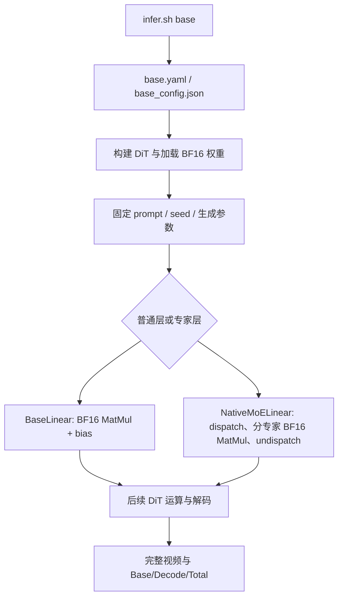
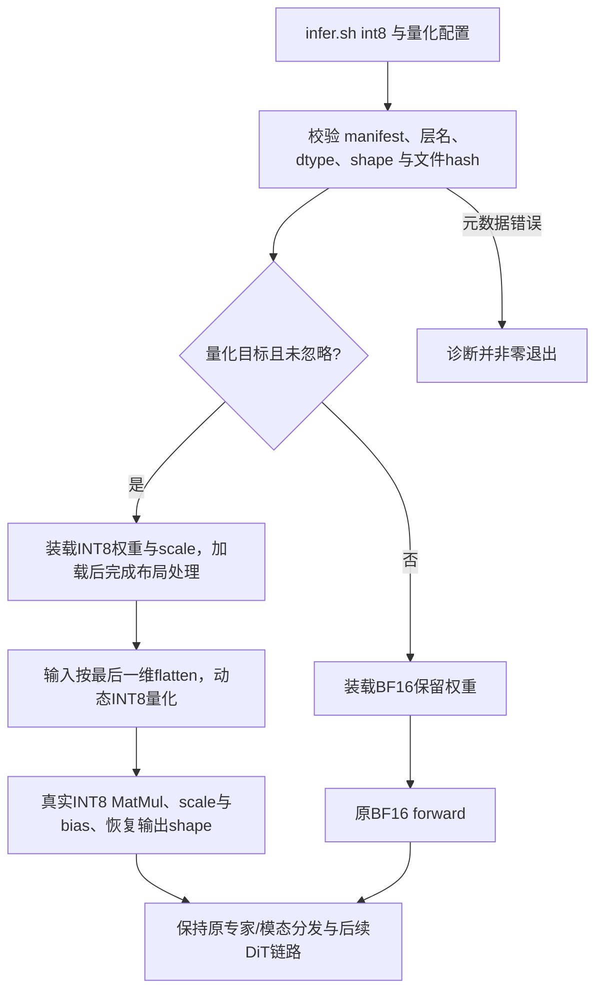

# 需求背景（required）

## 需求来源

- 任务名称：10月社区任务-daVinci-MagiHuman MatMul INT8 量化（A3）。
- 任务编号：`f7dd746fa3694d34b10c38b43ede8aad`。
- 任务页面：https://www.hiascend.com/activities/task-center/details/f7dd746fa3694d34b10c38b43ede8aad
- 目标代码仓：https://gitcode.com/cann/cann-recipes-infer 。
- 设计提交账号：`zhangwei0402`。
- 状态：设计方案送审版本；文中“拟采用”均为请求评审的工程方案，未声称实现或实机验证完成。

依据任务书及其 `test_cases/README.md`，完成模型量化适配、离线制品生成、正确性验证、视频盲测和同机收益对比。设计文档用于社区设计评审；代码仓 RFC/Issue 用于固定实现范围、版本和验收契约，两者互相关联。

## 背景介绍

daVinci-MagiHuman 的 DiT 主干采用 BF16 线性计算。Attention 的 QKV/输出投影及 MLP 的 up-gate/down 投影由 `BaseLinear` 或 `NativeMoELinear` 承载。本任务在保持既有生成模式、输入和配置的前提下，将选定热点线性层的核心矩阵乘切换为真实 INT8 计算。

### 现状分析

本轮已只读核对 `cann-recipes-infer` 提交 `7ae56d452a0c4eb23580d410ac45e46946b048ab`，观察到：

1. `inference/model/dit/dit_module.py` 的 `BaseLinear` 保存 BF16 权重，调用 `_BF16ComputeLinear` 执行计算。
2. `NativeMoELinear` 通过 `ModalityDispatcher` 分发输入，按专家切分权重及 bias，逐专家计算后重组输出。
3. `create_linear` 根据 `num_experts` 选择普通或多专家实现，因此接入不能只替换普通 `nn.Linear`。
4. `inference/model/dit/dit_model.py` 的 `get_dit` 负责构建模型并调用 `load_model_checkpoint`。上游完整加载实现不在该适配文件内，接入前需核对固定上游版本的加载及配置解析链。
5. `infer.sh` 当前模式白名单不包含 `int8`，仅新增 YAML/JSON 文件不足以使新入口生效。
6. 仓内 `compressed_tensors_w8a8_int8.py` 提供真实 INT8 动态量化与量化矩阵乘调用，可作为契约和布局处理的参考；是否直接复用需结合本模型接口评估。
7. 任务书提及的 Sana `a8w8` 示例在当前代码快照中使用 `float8_e4m3fn` 与 MX scale，不能直接当作本任务的 INT8 实现。

以上为代码观察，实际热点占比、模型层实例数、激活 shape、量化收益尚无实测结论。

# 需求分析（required）

## 需求描述

在 Atlas A3 单卡上完成可启停、可验证、可回退的 MatMul INT8 量化，提供确定且可追溯的转换产物，以及完整自验和贡献材料。

### 固定验收场景

| 项目 | 约束 |
|---|---|
| 生成模式 | base 文生视频 |
| 输出 | 448×256，5 秒 |
| 去噪参数 | 32 steps，CFG=2 |
| 随机种子 | 两档均固定 seed=42 |
| Cache | `dit_cache.method: NoCache` |
| 上游代码 | `209209b7086eba2020c5439265221495a8357322` |
| 对比条件 | 同机、同 batch、同输入和生成参数；仅量化字段、量化权重路径及输出目录允许差异 |

实际代码基线、四类权重 revision/hash、固定 prompt 清单和软件实装版本在基线采集后补齐并冻结。参考 README 展示耗时不作为本题固定验收基线。

### 外部组件依赖

| 组件 | 版本/来源与职责 |
|---|---|
| Python/CANN/PyTorch/torch_npu | 任务指定 Python 3.12、CANN 9.0.0、PyTorch 2.10.0、torch_npu v26.0.0；版本适配按模型 README |
| 上游模型代码 | 固定上游 commit，非覆盖合并 inference，保留仓内 NPU 适配 |
| MagiCompiler 与模型依赖 | 按模型 README 与 requirements 安装；本题固定 base 禁编译/NoCache，不因量化擅改编译模式 |
| 数据与权重 | daVinci-MagiHuman、T5Gemma、Stable Audio、Wan2.2 VAE；仅提供获取位置与revision/hash |
| 量化底层能力 | torch_npu 动态 INT8 量化与量化 MatMul；目标版本及实际shape需验证 |

### 内部适配模块

`dit_module.py` 的线性层与工厂、`dit_model.py` 的模型加载边界、模型配置解析/入口、`infer.sh` 的模式选择，以及本模型私有的转换与验证工具。优先评估 `module/quantization/` 的 INT8 接口，最终若修改公共代码须补全部直接调用方回归。

## 需求拆解

1. 识别 `linear_qkv`、`linear_proj`、`up_gate_proj`、`down_proj` 和实际启用专家路径中的热点，形成候选层及最终层清单。
2. 固定量化方案、权重/激活 dtype、scale 粒度和 shape、对称性、bias/output dtype、保存格式及元数据版本。
3. 实现离线权重转换或复用已有流程，固定校准/敏感度数据来源、revision、抽样规则、样本索引及校验信息。
4. 完成普通线性层及实际启用专家/多模态路径的量化接入、权重加载、reshape、分片和 bias 语义处理。
5. 以显式 `ignored_layers` 支持精度敏感层 BF16 回退；缺失或错误量化元数据报错，不使用占位 scale。
6. 新增 `config/int8.yaml`、`config/int8_config.json`，支持 `bash infer.sh int8`，默认旧配置行为保持不变。
7. 提供功能、异常、逐层/DiT block、连续生成、视频盲测、性能、存储和运行内存自验。
8. 补齐 README、技术文档、代码仓 RFC/Issue、规定七文件自验材料及 PR 证据。

### 范围边界

- 不量化 RoPE、RMSNorm、Softmax/FA、残差加法。
- 不开发独立 kernel 或 aclnn 算子工程。
- 不改变分辨率、时长、steps、CFG、输入或缓存策略以取得性能收益。
- 不以“INT8 后立即反量化回 BF16 MatMul”作为量化实现。
- 不提交权重或数据集大文件；提供获取、转换及校验方法。
- 优先将改动限制在本模型目录及对应技术文档；公共模块改动需单独列影响面并满足全部直接调用方回归。

# 详细设计（required）

## 模型线性层分析

普通线性计算的逻辑形状为：输入 `X[..., K]`，权重 `W[N, K]`，可选偏置 `b[N]`，输出 `Y[..., N]`。量化实现保持外部接口、leading dimensions、bias 及返回 dtype 语义。

`NativeMoELinear` 当前将专家权重沿输出维组织为 `[E*N, K]`。量化元数据必须记录专家数量、切分维、每专家层名/范围及对应 scale。不能将一个专家的 scale 广播为所有专家的 scale。

候选范围首先包括四类投影，但不预先宣称全部实例均量化。最终量化范围由热点、数值敏感度与完整视频质量共同确定；排除范围写入配置及产物清单。

### BF16 基线调用流程

基线数据类型以当前线性层 BF16 compute 为准，逻辑权重为 `[N,K]`，专家堆叠为 `[E*N,K]`。本题没有独立 TBE 标杆、ACLNN 原型或算子信息库条目：Checklist 对 TBE/AscendC host/kernel 的要求按任务书“模型线性层适配、不涉及独立算子工程”说明不适用，使用上述模型源码与调用流程作对应分析。

## 实现方案

### 1. 候选量化契约

拟以对称 W8A8、动态 per-token 激活及 per-output-channel 权重作为首个候选方案。该方案对应测试附件给出的配置方向；是否冻结需经接口版本核对、校准/敏感度证据及设计评审。

| 对象 | 候选契约 | 状态 |
|---|---|---|
| 原始输入与权重 | BF16 基线，原始权重只读 | 固定来源及 hash 待补 |
| 制品权重 | `int8`，逻辑保存形状 `[N,K]`；专家按原映射独立组织 | 拟采用 |
| 权重 scale | 每输出通道一个，逻辑形状 `[N]`，制品保存 FP32 | 拟采用；运行时布局/类型须核对目标版本 |
| 激活 | 运行时动态生成 `int8`；flatten 后输入 `[M,K]` | 拟采用 |
| 激活 scale | per-token，逻辑形状 `[M]`，FP32 | 拟采用；以目标 API 语义为准 |
| 零点 | 对称量化，无额外非零 zero-point | 拟采用 |
| 矩阵乘 | INT8×INT8 的量化 MatMul；不是浮点伪量化 | 硬要求 |
| bias | 保留浮点语义，不将浮点 bias 误作 INT32 累加域 bias | 具体调用契约待核对 |
| 输出 | 首选 BF16 量化 MatMul 输出，再按原线性层接口处理要求的返回 dtype | 拟采用；需数值验证 |

拟采用以下可审计的离线权重量化算法（工程设计，非官方额外验收阈值）：对 FP32 计算视图的每个输出通道 `j`，令 `a_j=max_k(abs(W[j,k]))`。非零通道 `s_w[j]=a_j/127`；全零通道定义 `s_w[j]=1` 且 `Q_w[j,:]=0`，并在元数据中登记零值通道。量化权重为 `Q_w=clamp(round_to_nearest_even(W/s_w),-127,127).to(int8)`，反量化方向为 `W_hat=Q_w*s_w`。全零通道规则来自明确输入条件，不能用于替代缺失scale。

运行时动态激活量化由目标版本 `npu_dynamic_quant` 实现；其 scale 方向与边界/舍入语义必须在接口核对及小张量参考验证时确认，不能仅按权重算法推定完全一致。逻辑前向为 `Y_hat=(Q_x @ Q_w.T) * s_x[:,None] * s_w[None,:] + bias`。最终按原层输出dtype返回。权重与激活均真实进入INT8矩阵乘。

KG 中 `npu_quant_matmul` 接口文档及仓内 INT8 实现可支持候选路线的初步分析。KG 检索资料不是本机目标 torch_npu 版本和实际 shape 已验证的证据。

### 2. 模块和配置接入

拟在 `models/davinci-magihuman/inference/model/` 下提供模型私有量化适配，保持原非量化路径可用。具体文件名在方案冻结时确定。

- 在模型构建与加载边界传入量化配置；所有目标层使用稳定的完整层名匹配目标/排除清单。
- 为 `BaseLinear`、`NativeMoELinear` 分别建立量化 runtime 映射，复用输入/输出和分发接口。
- 普通层按 leading dimensions flatten/restore；专家层保留 dispatch/undispatch 顺序，分别匹配权重、scale 和 bias。
- 权重转置、亲和布局等运行时处理只在加载后完成一次，避免每次 forward 重排权重。
- `ignored_layers` 的 BF16 回退在构建/加载阶段显式决定并记录；不能以运行时异常吞掉错误元数据。
- 新增 int8 模式同时覆盖启动白名单、配置选取及完整配置解析链。

量化配置至少包含：`enabled`、`mode`、`activation_method`、`weight_granularity`、`activation_granularity`、`quantized_weight_path`、`ignored_layers`、`fallback_dtype`。制品位置和 scale 位置可由明确的 manifest/index 解析，不硬编码开发机路径。

### 3. 制品与加载契约

转换工具读取固定版本原始权重，输出量化权重、scale、保留浮点张量以及可审计 manifest。manifest 至少包含：

- schema 版本、原始权重 revision/hash、转换工具代码身份及转换参数；
- 各层全名、原始/量化 dtype 与逻辑 shape；
- weight/activation scale 的粒度、方向、shape、dtype、对称性；
- 专家和模态映射、切分维、bias/output dtype；
- 目标/排除层、回退原因及保留张量列表；
- 制品文件索引、大小与 SHA256。

加载时完整核对层名、文件身份、shape、dtype、scale 数值有效性和格式版本。缺失量化张量、错误 scale、层映射不完整或不兼容 schema 应诊断并失败退出。

加载位置需结合固定上游的 `load_model_checkpoint` 与配置解析实现确定。不能将 BF16 checkpoint 直接加载到 INT8 参数后认为转换完成，也不能用一律 `strict=False` 掩盖缺失张量。

转换复跑使用同一输入和参数，核对产物张量及元数据身份；涉及容器格式时间戳等非语义差异时分别说明，不伪造“字节一致”。

### 4. INT8 调用流程与内存生命周期

与基线的差异是目标层装载INT8制品并执行动态激活量化；分发顺序、返回shape、bias、生成参数与非MatMul链路保持原契约。权重转置/格式处理在加载后执行一次，避免每个forward重复拷贝。

离线转换按原始权重分片读取、量化后写入制品并释放临时FP32/BF16视图。运行时量化目标层不长期保留完整BF16副本；显式回退层保留必要BF16权重，并计入总制品大小。专家按原输出维切分，scale和bias同步切分；零token模态组跳过非空MatMul调用并恢复正确空输出结构。

单层量化权重的基本存储估算为 `N*K` 字节，加 FP32 channel scale 的 `4*N` 字节；BF16对应权重为 `2*N*K` 字节。元数据、bias、回退权重和容器开销须另计，因此不以此局部公式推断整模型必然减半。激活量化临时空间至少含 `M*K` 个INT8元素及 `M` 个FP32 scale；实测峰值还须计入底层workspace和输出，不用静态估算替代内存验证。

本题不设计AscendC分核、UB分块或tilingKey，这些由复用的官方量化算子负责；本模型侧负责契约、生命周期与调用粒度。

### 5. 敏感度与回退

固定校准/敏感度数据集及独立质量验收样本，先登记后评测，不依据最终验收结果反向选择校准样本。

逐候选层和至少一个 DiT block 记录中间张量差异。预先定义误差指标、归一化方式、近零输出处理和阈值；最终视频质量不由单个张量指标替代。

不满足预定指标的敏感层保留 BF16，并记录 `ignored_layers`、原因和性能影响。最终范围变更时同步更新 RFC、配置、manifest 和验证清单。

### 6. 性能方案

首先分析热点占比及目标输入 shape，再选择量化层和复用方式。保持既有 QKV/up-gate 融合边界，避免无依据地拆小 MatMul；量化开销、重排开销、专家分发及目标 block 耗时分别采集。

正式端到端测量与 profiling 采集采用一致且预先说明的协议；记录 profiler 是否开启，不混合不同协议的耗时作为一组结果。NPU 同步必须在计时结束前完成。

公共模块无改动时，明确记录影响限于本模型。若最终修改公共代码，先建立所有直接调用方依赖清单，再展开功能、精度与代表性性能回归。

## 支持硬件

| 支持平台 | 本任务状态 |
|---|---|
| Atlas A3 单卡 | 指定验收目标；尚未开展本设计的实机验证 |
| 其他平台/其他生成模式 | 不作为本题已验证支持范围 |

## 约束限制

- 未完成实际 shape 和目标版本核对前，不宣称所有候选层可运行该 INT8 路线。
- 保留 base 行为；实际启用专家/多模态路径不可漏验。
- 外部数据、权重仅给获取方法和身份；许可证按真实来源核对。
- 本设计不使用通用文本 Benchmark 替代任务指定的视频评测。

# 特性交叉分析

| 交叉特性 | 风险与处理 |
|---|---|
| 多专家/多模态分发 | 按实际启用路径核对每专家权重、scale、bias与分发顺序；空token分组显式处理 |
| QKV/up-gate融合 | 保持已有大粒度投影，不未经分析拆分成额外小MatMul |
| BF16回退 | 仅按显式目标/排除清单决定，记录回退原因、制品大小与收益影响 |
| 配置与加载 | 默认关闭行为不变；量化制品schema/shape不匹配时报错，不默默改走BF16 |
| Cache/编译/Offload | 正式对比固定base的NoCache及既有编译/Offload配置；此任务不通过开关其他优化获得收益 |
| 公共模块 | 模型私有适配优先；若触及公共代码，列出完整直接调用方并触发对应回归 |
| Profiling与中间张量抓取 | 与正式计时批次分开标记，及时释放诊断张量，不混入不同采集协议的耗时 |

# 可维可测分析

## 精度标准/性能标准

| 维度 | 方法 | 判据与来源 |
|---|---|---|
| 真实量化 | 核对权重/激活/scale，并采实际算子 profiling | 目标 INT8 MatMul/量化线性算子实际执行；任务测试附件 |
| 功能 | 启停、完整生成、正常/专家路径、回退、异常元数据 | 关闭回 base；错误元数据可诊断且非零退出 |
| 数值 | 普通层、启用专家/模态及至少一个 DiT block 对比 | 无 NaN/Inf，符合 RFC 预先固定阈值；阈值待补 |
| 最终质量 | 至少5组固定prompt：单人、多人、肢体动作、镜头运动、复杂背景；两档同seed/参数 | 2名指定验收人均未发现稳定可辨识退化 |
| 端到端性能 | 每档预热≥1、正式≥3，记录 Base/Decode/Total 与均值/中位数/极差 | INT8 Total 中位耗时下降且超过 BF16 波动范围 |
| 目标收益 | 算子调用数、累计耗时、量化/反量化开销和 block 耗时 | 目标 MatMul 或目标 block 累计耗时下降 |
| 存储 | 对账 BF16 权重、INT8 权重、scale/元数据、回退权重和总制品 | 同范围 INT8 总制品存储低于 BF16 |
| 运行内存 | 加载后、生成峰值、连续5次生成后的 NPU/Host 内存；重复加载/推理序列 | 占用不得持续增长；无官方固定显存下降百分比 |
| 可复现性 | 原权重获取→转换→配置启动→自验→结果采集 | 命令完整，版本和校验可追溯 |
| 公共回归 | 公共改动时所有直接调用方功能/精度与代表性能 | 旧配置/默认行为不变，代表性能不低于基线波动下界 |

性能中定义 `B=median(Total_BF16)`、`I=median(Total_INT8)`，要求 `I<B` 且 `B-I>δ_B`。`δ_B` 必须按 RFC 预先约定的算法从 BF16 正式结果计算；本草案暂不把某种算法或固定百分比冒充官方规定。

盲测记录主体、语义、构图、动作、时序、色彩、音画一致性和伪影。两名验收人的指定方式需在正式盲测前确认，不能以开发者单人观感替代。

## 兼容性分析

原 base 配置及默认关闭量化的行为保留。量化层对外遵循原线性层的输入、返回 dtype、shape 和 bias 语义；不擅自迁移到通用 LLM Prefill/Decode、KVCache 或 online 服务接口。

只要配置、产物契约或排除清单变化，须重验受影响的数值、质量、性能和版本链。

## 交付与评审计划

1. 设计 PR 和代码仓 RFC/Issue 完成方案讨论；设计评审通过后正式开发，提交验收前设计 PR 合入。
2. 代码、配置、转换/自验脚本提交 `cann-recipes-infer` 对应模型目录；README 与技术文档分别更新。
3. 私仓 `task_submission/` 保存规定7文件；验收 ZIP 根目录直接放相同7文件，不额外套目录。
4. 上传说明给出受测 commit、大产物获取位置和校验信息；私仓按流程为 `Ascend-CANN` 提供访问权限。
5. 通过 pre-commit、CI、目标模型实机测试和条件回归后申请验收；官方测试通过后按通知推进正式代码 PR。
6. 本题讨论帖要求至少每3个工作日更新进展；发布内容只报告已发生事实。

预计完成时间须结合方案评审与实际测量后填入正式 RFC；平台验收申请截止为北京时间2026年11月2日00:00，提交前留出反馈和整改时间。

## 开发前冻结项与请求评审项

| 待补项 | 完成条件 |
|---|---|
| 基线与候选层 | 固定适配仓基线、权重身份、实际shape、热点占比 |
| 量化算子契约 | 目标版本、dtype/layout、scale、bias及舍入/零值规则确认 |
| 数据 | 开源校准集来源/revision/抽样/hash与独立盲测prompt清单 |
| 数值判据 | 指标、阈值、近零规则在优化前固定并评审 |
| 性能判据 | 计时边界、波动算法及正式/Profiler协议固定 |
| 流程 | 设计目录/标题评审确认、双人指定方式、设计Checklist核对 |

上述运行产物和数值字段在开发前RFC与基线阶段补齐并冻结；本PR请求评审结构、契约、范围和验证设计，不将待实测内容写成既有结果。

## 官方设计Checklist适配自查

| Checklist类别 | 本题对应内容/适用性 |
|---|---|
| 提交位置、标题、CLA、构建 | tasklist下本题任务ID/账号/docs/design.md；PR按社区任务格式；CLA与CI以实际平台检查为准 |
| 需求来源与背景 | 对应任务页面、任务书、固定适配仓commit和现状分析 |
| 标杆dtype、格式、源码和流程图 | BF16 BaseLinear/NativeMoELinear、逻辑shape、具体源码文件及BF16流程图；不涉及TBE标杆 |
| 外部依赖/内部适配模块 | 已列组件版本、依赖来源及模型内接入边界 |
| 算子原型与约束 | 保持模型线性层forward契约；无新ACLNN/AscendC原型 |
| 调用方式与总体设计 | PyTorch/torch_npu调用；量化契约、转换加载、公式、运行流程与内存生命周期 |
| host分核/UB分块/tilingKey/kernel设计 | 按本题§2.2说明不适用；复用官方算子，不开发独立kernel |
| 流程差异与原因 | 由BF16目标投影变为真实INT8调用，保留其他模型语义 |
| 支持硬件与限制 | Atlas A3单卡；其他模式/平台不宣称已验证 |
| 特性交叉 | 专家分发、融合、回退、配置、Cache/编译/Offload、公共模块与采集协议 |
| 精度/性能/兼容性 | 按任务测试附件建立正式判据、相同基线协议、盲测与条件回归 |

## 参考资料

- 本题任务书与测试附件，以任务页面提供ZIP为准。
- 模型适配源码：`cann-recipes-infer@7ae56d452a0c4eb23580d410ac45e46946b048ab`，主要文件为 `models/davinci-magihuman/inference/model/dit/dit_module.py`、`dit_model.py`、模型入口/配置及 `infer.sh`。
- INT8实现参考：同仓 `module/quantization/compressed_tensors/compressed_tensors_w8a8_int8.py`。
- 官方设计Checklist：https://docs.qq.com/sheet/DUHVGUFdmSFRjVFFU?tab=000001 。
- 社区流程：https://www.hiascend.com/developer/activities/cann-community-task 。
- torch_npu量化MatMul文档：KG节点 `opplugin_docs_context_torchnpunpuquantmatmul_pertoken_scale`，原始来源 `cann-ops/op-plugin/docs/context/torch_npu-npu_quant_matmul.md`；使用时另核对目标版本。
