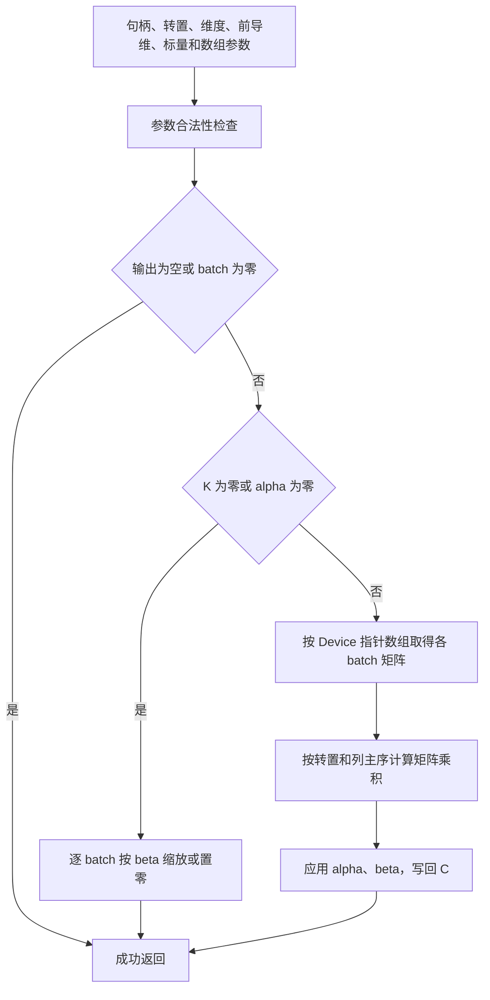
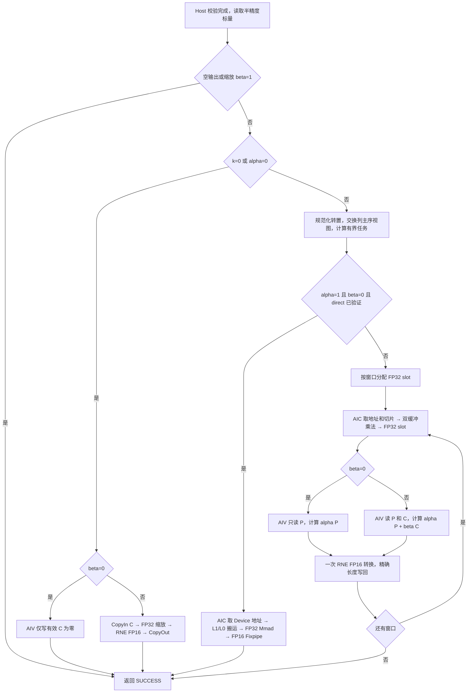

# aclblasHgemmBatched 算子设计文档（Ascend 950PR）

| 项目 | 内容 |
| --- | --- |
| 任务 | 10月社区任务-aclblasHgemmBatched算子开发（950） |
| 公开任务 ID | `fe48759fdaaf4afb80ecbf5a758a1123` |
| 贡献者 / 团队目录 | `xiaoyux1`（个人提交） |
| 文档日期 | 2026-10-28，Asia/Shanghai |
| 阶段 | 设计送审；本文描述拟实现方案，尚未进行 950PR 编译、精度或性能实测 |
| 目标环境 | Ascend 950PR，`arch35`，CANN 9.1.0 |
| 代码分析基线 | `cann/ops-blas@05b96ea22cea926ecfd43fc7ac691a795522bd61` |
| 模板 / 目录分析基线 | `cann/cann-ops-competitions@b11e879347ec583b6f0a309aeade8050c5d541ee` |
| 设计提交目录 | `04_tasks/01_community-task-2026/tasklist/fe48759fdaaf4afb80ecbf5a758a1123-aclblasHgemmBatched/xiaoyux1/docs/design.md` |

# 需求背景（required）

## 需求来源

依据[公开任务页面](https://www.hiascend.com/activities/task-center/details/fe48759fdaaf4afb80ecbf5a758a1123?menu=tasks)及附件 `aclblasHgemmBatched_Atlas950PR_task_doc.md`，补齐 ops-blas 在 Ascend 950PR 上的半精度指针数组批量 GEMM。接口、目录和验收要求以本任务书为依据；设计提交位置采用[当前社区流程 #39](https://gitcode.com/org/cann/discussions/39)和[设计仓任务目录说明](https://gitcode.com/cann/cann-ops-competitions/blob/b11e879347ec583b6f0a309aeade8050c5d541ee/04_tasks/01_community-task-2026/README.md)。任务书中的旧仓名 `cann-competitions` 以当前有效设计仓 `cann-ops-competitions` 对应处理。

输入材料指纹用于固定本设计的需求版本：

| 材料 | SHA256 |
| --- | --- |
| 任务书 | `a58990f5145861ec1c45586588d5b0b95917bca39d6b816c6495c3412dad27de` |
| `hgemm_batched_test.csv` | `55957f9b14d676acb7ca15910e7d9f799c9047227df4689a22acbb279128d018` |
| `gpu_baseline.csv` | `e66b0290797488462cf9f38a9d2eb49bf874533b91b59d555270792bf7c824dd` |

## 背景介绍

### 标杆接口与逻辑

语义标杆为 cuBLAS `cublasHgemmBatched`，接口参数次序与任务 API 一一对应。本文固定参考 [cuBLAS 12.9 文档的 gemmBatched 章节](https://docs.nvidia.com/cuda/archive/12.9.0/cublas/index.html#cublas-t-gemmbatched)，并保留任务书指定的[在线文档入口](https://docs.nvidia.com/cuda/cublas/index.html#cublas-t-gemmbatched)。这里的参考文档版本不代表附件 GPU 基线的实测 CUDA/cuBLAS 版本；基线 CSV 未提供该信息，需验收方确认。

cuBLAS 未公开本接口内部 kernel 源码，因此以下是依据公开 API 的语义流程，不将其描述为 NVIDIA 内部实现。独立 golden 的公开实现来源为 Netlib BLAS 3.10.0：`CBLAS/src/cblas_sgemm.c` 调用 `BLAS/SRC/sgemm.f`；后者可从 [Netlib 固定版本源码](https://www.netlib.org/lapack/lapack-3.10.0/BLAS/SRC/sgemm.f)核对参数、转置及缩放逻辑。原 TBE 文件、算子信息库、既有 ACLNN 复用项均不适用：本任务为 cuBLAS 标杆、BLAS 句柄式 kernel 直调。



任务与标杆的范围差异：本任务只接收 Host 上的 FP16 alpha/beta；不扩展 cuBLAS 的 Device pointer mode、不提供 strided-batched 或 grouped 接口。错误码采用 ops-blas 定义，非法转置枚举必须返回 `ACLBLAS_STATUS_INVALID_ENUM`。空数组的校验顺序按任务书 §2.5 明确要求实现，而不从其他 BLAS 实现推断放宽。

### 同仓现状及可复用边界

以下路径均相对于上述 ops-blas 固定 SHA：

| 文件 / 符号 | 已有能力 | 本次处理 |
| --- | --- | --- |
| `include/cann_ops_blas.h`、`include/cann_ops_blas_common.h` | 公共句柄、状态码、转置枚举；尚无本 API 和 `aclblasHalf` 定义 | 新增统一公共 FP16 类型与 API 声明，保持 C / C++ 可用 |
| `blas/gemm_batched/arch35/gemm_batched_host.cpp:54` | SgemmBatched 校验、stream、workspace、列主序转换及调度 | 复用工程方法；其非法枚举返回 INVALID_VALUE，本任务改为 INVALID_ENUM |
| 同文件 `ApplyColumnMajorSwap`（约 219 行） | 交换 A/B、M/N、ld 和转置标志 | 采用下文证明的列主序映射 |
| `blas/gemm_batched/arch35/gemm_batched_cube_impl.h:48` | FP16 输入 traits、L1/L0 双缓冲和 FP32 L0C | 复用 Cube 内层模板及事件同步 |
| 同文件 `GbProcessMNTiles`（约 220 行） | 泛型 GM 张量及乘法循环 | 由本任务 wrapper 提供正确的输入切片、FP32 临时输出或 FP16 输出张量 |
| 同文件 `GbProcessOneTask`（约 320 行） | 输出地址固定解释为 `float*` | 不将 FP16 Carray 传给该 wrapper；新建 Hgemm 的类型正确 wrapper |
| `blas/gemm_batched/arch35/gemm_batched_kernel.cpp:272` 起 | FP32 临时乘积及后处理框架 | 参考数据流，独立处理 FP16 舍入和 beta=0；其 FP16 CAST_ROUND 不直接当作最近偶数舍入证明 |
| `test/frame/verify.h:293` 附近 | 通用半精度默认阈值 2^-9 | 为本任务显式提供 2^-10 和特殊值策略，避免改变无关算子默认行为 |
| `blas/CMakeLists.txt`、`cmake/test.cmake` | 源文件发现、单算子过滤、GTest 与 BLAS 链接 | 核对跨目录模板依赖和固定 Netlib 链接，不能把任意系统 OpenBLAS 当作 Netlib 3.10.0 |

# 需求分析（required）

## 需求描述

对 batch `b∈[0,B)`，执行：

\[
C_b(i,j)=\alpha\sum_{p=0}^{K-1}\operatorname{op}(A_b)(i,p)\operatorname{op}(B_b)(p,j)+\beta C_b^{old}(i,j),
\quad i\in[0,M),\ j\in[0,N).
\]

输入矩阵、输出矩阵、alpha、beta 均为 IEEE binary16。计算计划使用 FP32 累加和 FP32 标量后处理，最后一次转换为 FP16；任务按混合容差验收，不要求逐 bit 复现 GPU 累加次序。对实数，OP_C 与 OP_T 相同。

## 需求拆解

| 编号 | 必须满足的行为 | 设计 / 验证落点 |
| --- | --- | --- |
| R01 | 统一 `aclblasHgemmBatched` 公共 API，950PR 不另建私有平行接口 | 公共头文件及 C / C++ 编译检查 |
| R02 | Device 指针数组，各 batch 矩阵地址可不相邻 | kernel 按 batch 取地址；离散分配用例 |
| R03 | 列主序、9 种 N/T/C 组合、合法 ld padding | 索引证明、4 种实数内核布局、哨兵检查 |
| R04 | handle、枚举、负维度、ld、标量和外层数组错误返回正确 | Host 分层校验与负向 GTest |
| R05 | 判空先于 no-op；batch=0 不校验数组；空输出不解引用 Device 数组 | no-op 交叉用例和无 kernel 检查 |
| R06 | k=0 / alpha=0 只缩放 C；beta=0 不读取旧 C | 独立置零与缩放分支；C 为 NaN 用例 |
| R07 | handle stream 顺序、原地覆写 C、padding 保持 | 异步调用、流次序和物理存储哨兵 |
| R08 | 950PR / arch35 / CANN 9.1.0，同族 kernel 直调 | 指定目录、单算子构建及最小设备闭环 |
| R09 | Netlib 3.10.0 FP32 golden 后最近偶数转换 FP16 | 独立参考、转换边界和链接溯源 |
| R10 | 每 batch 混合容差及非有限值规则 | 算子级 comparator，不能只汇总全部 batch |
| R11 | warmup 5，10 个有效样本，msprof task duration | 原始 profiling、完整调用统计和版本绑定 |
| R12 | 单性能 case 倍率≥0.4，200 case 倍率算术平均≥0.5 | 不丢失、不去重的基线映射和完整报表 |
| R13 | 任务附件全量及任务书附加覆盖 | 1200 原始用例保留；补充分布和上界用例 |
| R14 | 代码、测试、说明、报告和日志可复现 | 分阶段交付；设计通过后才提交验收 |

# 详细设计（required）

## 算子分析

### 接口与数据契约

在 `include/cann_ops_blas.h` 新增：

```cpp
aclblasStatus_t aclblasHgemmBatched(
    aclblasHandle_t handle,
    aclblasOperation_t transa, aclblasOperation_t transb,
    int m, int n, int k,
    const aclblasHalf* alpha,
    const aclblasHalf* const* Aarray, int lda,
    const aclblasHalf* const* Barray, int ldb,
    const aclblasHalf* beta,
    aclblasHalf* const* Carray, int ldc,
    int batchCount);
```

公共类型拟采用 CANN 的 `aclFloat16` 存储类型定义 `aclblasHalf`，在接入时以 CANN 9.1.0 实际公共头文件完成 C / C++ 兼容及 `sizeof(aclblasHalf)==2` 检查后固化。Host 标量通过 ACL 半精度转换接口按位解释为 FP32；禁止把承载 binary16 的整数直接 `static_cast<float>`。类型定义只保留一份，不能在 arch35 私有文件重复定义公共类型。

| 参数 | 所在内存 / 类型 | 约束 |
| --- | --- | --- |
| handle | Host / `aclblasHandle_t` | 有效库句柄，携带 stream 和 workspace |
| transa、transb | Host / `aclblasOperation_t` | N/T/C；无默认值；非法枚举返回 INVALID_ENUM |
| m、n、k、batchCount | Host / int | 非负；运行时确定；测试覆盖到维度 16384、batch 65536 |
| alpha、beta | Host / `const aclblasHalf*` | 始终非空；接口内读取值，传递 FP32 标量给 kernel |
| Aarray、Barray | Device / 只读指针数组 | batchCount>0 时外层数组地址非空；元素为 Device FP16 矩阵首地址 |
| Carray | Device / 指针数组 | batchCount>0 时外层地址非空；各 C 为可写 FP16 输出，原地覆写 |
| lda、ldb、ldc | Host / int，以元素为单位 | `lda≥max(1,transa==N?m:k)`；`ldb≥max(1,transb==N?k:n)`；`ldc≥max(1,m)` |

矩阵物理形状分别为 `A: lda×(transa==N?k:m)`、`B: ldb×(transb==N?n:k)`、`C: ldc×n`。前导维 padding 合法，不等于支持任意 stride。各 batch 之间不要求连续；无 broadcast。调用者保证实际访问的矩阵分配有效、C 的 batch 写区不重叠，且 C 不与被读取的 A/B 区间重叠。任务未要求额外别名运算能力，不增加同步扫描 Device 数组来检测别名。

### 列主序索引与内部布局证明

以零起始索引表示：

```text
op(A)(i,p) = A[i + p*lda]   if transa==N
             A[p + i*lda]   otherwise
op(B)(p,j) = B[p + j*ldb]   if transb==N
             B[j + p*ldb]   otherwise
C(i,j)     = C[i + j*ldc]
```

利用 `C^T = alpha·op(B)^T·op(A)^T + beta·(C_old)^T`，把同一内存视为行主序转置视图：

```text
M' = n, N' = m, K' = k
A' = Barray, B' = Aarray
lda' = ldb, ldb' = lda, ldc' = ldc
transA' = normalize(transb), transB' = normalize(transa)
normalize(N)=N, normalize(T)=normalize(C)=T
```

原列主序矩阵内存本身已对应其转置的行主序视图，所以交换后保留各自 N/T 状态，不再反转一次标志。例如原 NN：内部直接计算 `B_row(n,k)·A_row(k,m)`；内部 `(j,i)` 的输出地址为 `j*ldc+i`，恰好是原 C 的 `(i,j)`。原 NT 对应内部 TN，其余组合依此推导。通过非方阵、小质数、不同 padding、全部 9 组合验证，避免方阵掩盖交换错误。

### Host 校验与短路顺序

1. handle 为空：返回 `ACLBLAS_STATUS_HANDLE_IS_NULLPTR`。
2. alpha/beta 任一为空：返回 `ACLBLAS_STATUS_INVALID_VALUE`。
3. 转置不在 N/T/C：返回 `ACLBLAS_STATUS_INVALID_ENUM`。
4. 维度或 batch 为负，或任一 ld 不满足公式：返回 `ACLBLAS_STATUS_INVALID_VALUE`。
5. batchCount>0 时校验 Aarray/Barray/Carray 外层指针，任一为空返回 INVALID_VALUE；batchCount=0 跳过数组校验。
6. m=0、n=0 或 batchCount=0：返回 SUCCESS；不读 Device 指针数组，不启动 kernel。
7. 按 binary16 解码 alpha/beta。若 k=0 或 alpha=±0，进入 C 缩放分支；beta=±0 直接写正零，不读旧 C；beta=1 可直接成功返回；其余 beta 读取 C，FP32 乘后转回 FP16。
8. 普通 GEMM：beta=±0 选择不读取旧 C 的 epilogue；其余情况读取 C。启动在 handle stream 上的 kernel，正常入队返回 SUCCESS。

步骤 1–5 的具体多重错误优先级是本实现的稳定选择；任务明确要求的相对顺序是所有必要判空先于步骤 6。`k=0` 也不豁免 batchCount>0 的外层数组判空。缩放分支不加载 Aarray/Barray 中的元素及 A/B 内容。Device 数组元素是否有效由调用者保证；Host 不 D2H 拷贝扫描，不为提前报告异步设备错误插入 stream 同步。

已有内存、架构、launch 失败使用 ops-blas 对应错误转换（ALLOC_FAILED、ARCH_MISMATCH、EXECUTION_FAILED 等）；设备执行中的异步错误由调用者同步时观察。返回 SUCCESS 表示已完成 Host 校验和入队，并不替代设备测试成功。

## 算子实现

### 工程与依赖

新增实现严格落在任务指定 `blas/gemm/arch35/`：

```text
include/cann_ops_blas.h                 # API 与公共 FP16 类型的单一定义
blas/gemm/arch35/
  hgemm_batched_host.cpp                 # 参数检查、分派、workspace 与直调
  hgemm_batched_tiling.h                 # Host/Kernel 共用参数与 key
  hgemm_batched_kernel.cpp               # Cube wrapper、FP16 epilogue、缩放
test/gemm/hgemmBatched/arch35/
  CMakeLists.txt                        # 复用 ops_blas_add_gtest_tests
  test_hgemm_batched.cpp                 # CSV、golden、comparator 和 GTest
  hgemm_batched_test.csv                 # 原始用例与可追踪的补充用例
  README.md                            # 构建、精度、性能、输入与报告方法
```

根据实际源文件过滤规则接入 CMake，`hgemm_batched` 命名保持一致，核对指定测试目录的大小写。仅在职责确有需要时拆文件；不复制整套通用 GEMM 工程。可复用的 inline Cube 模板从 gemm_batched 引用；若其当前 include 路径不满足单算子构建，补充最小显式依赖或抽取同族共享头，不依赖其他算子 .cpp 偶然同时编译。

内部依赖：公共 handle/stream/workspace、状态码、平台核心数查询、GEMM Te 模板、Ascend C 向量与搬运接口、库日志和 GTest 框架。外部依赖：CANN 9.1.0 工具链和运行时、950PR、Netlib BLAS 3.10.0、GTest、msprof。cuBLAS 只作为语义和性能标杆，不成为 NPU 实现的动态依赖。不新增 ACLNN、图模式注册、infer shape、PyTorch 或 TBE 部件。

### 3.2.1 Host 与 Tiling 设计

#### 分派与 tilingKey

直调工程中由 Host 选择 wrapper / 模板实例，不强加图算子注册机制。逻辑 key 与 kernel 参数保持一致：

| key | 条件 | 行为 |
| --- | --- | --- |
| NOOP | 输出为空 / batch=0，或缩放且 beta=1 | Host 直接返回，无 kernel |
| ZERO | k=0 / alpha=0，且 beta=0 | AIV 仅写 C 的有效区 |
| SCALE | k=0 / alpha=0，且 beta≠0、1 | AIV FP32 缩放并转换 |
| GEMM_DIRECT_NN/NT/TN/TT | 内部转置组合，alpha=1、beta=0，FP16 Fixpipe 路径已验证 | FP16 输入、FP32 累加、直接 FP16 输出 |
| GEMM_TEMP_NN/NT/TN/TT + EPILOGUE_B0/BX | 通用标量或 direct 路径尚不可用 | FP32 乘积 workspace + AIV 后处理；B0 完全不读 C |
| VECTOR_SMALL | 小 / 窄形状经测量选择，或用户 workspace 不足的正确性保底 | 不分配全矩阵临时区的 FP32 累加向量实现 |

附件 200 个 PF 用例全部为 alpha=1、beta=0，因此直接 FP16 输出是优先验证的性能路径，而非把现有 `float*` 输出强转为 half。需在 CANN 9.1.0 / arch35 验证 `CopyL0C2GM`/Fixpipe 的目标类型、舍入和尾块支持；不满足时通用路径承担正确性并如实报告性能，不能宣称 direct 路径已经可用。FP16 的最终舍入必须经 midpoint、溢出、非正规数专项用例验证。

Tiling 数据包括：原始 m/n/k、交换后的 M'/N'、ld、batchCount、布局 key、Mt/Nt/K1/K0、mTiles/nTiles、totalTasks、usedAic/usedAiv、taskBase/taskCount、slotStride、FP32 alpha/beta、epilogue key 和尾块参数。地址偏移、任务数、workspace 长度先提升为 uint64_t / size_t，逐步做乘加溢出检查。传给内部 uint32_t API 前校验可表示性，不能静默截断；避免 `(x+d-1)` 在 int 内溢出。

#### 分核及覆盖证明

取候选输出 tile `(Mt,Nt)`，令 `Tm=ceil(M'/Mt)`、`Tn=ceil(N'/Nt)`、`T=B*Tm*Tn`。查询 `GetAicCoreCount()` / `GetAivCoreCount()`，按实际任务数启动 `min(T,availableCores)`，禁止固定为某台设备的 28 核。查询失败返回对应错误；非空工作不启动 0 核。

初始分配采用 `task=coreId+s*usedCores`，所有 `task<T` 各有唯一余数，故无遗漏、无重复。解码：`b=task/(Tm*Tn)`，`r=task%(Tm*Tn)`，`tm=r/Tn`，`tn=r%Tn`；每个 task 独占一个 batch 的一个输出矩形。尾部有效大小为 `min(Mt,M'-tm*Mt)`、`min(Nt,N'-tn*Nt)`。K 不跨核拆分，避免首版引入 split-K 归约和额外舍入。

例：内部 M'=129、N'=65、Mt=Nt=128、B=2，T=4；四个 task 覆盖两个 batch 的 128×65 和 1×65 有效区。availableCores≥4 时只启动 4 个 AIC。对大 batch 小矩阵，优先 batch 并行；仅在有效 task 不足时细分 M/N。后续 batch 交错或蛇形次序可参考同仓策略，但必须保留同一双射和覆盖证明。

缩放及 epilogue 在每个有效列 / 行片段上分配连续元素块；不把 `ldc*n` 含 padding 的物理区当作有效数据长度。对 Q 个块使用相同有界调度，尾块只写有效元素。

#### LocalMemory 预算与候选 tile

初始候选：Mt=128、Nt=128、K1=128、K0=64，FP16 输入、FP32 L0C；小形状考虑 32/64 级 tile。先查询 / 核对目标 SDK 与芯片实际容量，再使用候选。下表是算法需求预算，不是本机实测容量：

| 空间 | 双缓冲需求公式 | 128×128 候选 |
| --- | --- | --- |
| L1 | `2*(Mt*K1+K1*Nt)*sizeof(half)` | 128 KiB |
| L0A | `2*Mt*K0*sizeof(half)` | 32 KiB |
| L0B | `2*K0*Nt*sizeof(half)` | 32 KiB |
| L0C | `2*Mt*Nt*sizeof(float)` | 128 KiB |
| AIV UB | 保守 `2*E*(4+2+4+4+2)+R = 32E+R` | E=2048 时 64 KiB + R |

R 包含队列、API 临时空间和对齐保留；UB 列举了乘积 FP32、旧 C FP16、旧 C FP32、输出 FP32、输出 FP16 的双缓冲。实际实现通过生命周期复用可降低预算，但在固化前不按理想复用省略空间。beta=0 分支不分配或搬入旧 C 缓冲。

必须分别满足各物理存储预算≤可用容量；这些空间不共用同一个 UB 总额。E 按 `floor((UB-R)/32)` 与 API 对齐粒度向下选取，若为零则缩小方案或报告资源错误。K 尾块用支持的有效长度和补零装载；只对片上补齐区填零，不越过用户矩阵分配读取。M/N 的 Fixpipe 和搬运须按真实长度写出；使用当前 arch35 支持的精确长度搬运 / 掩码，对齐扩展不得污染下一列及 padding。

#### Workspace 与生命周期

通用路径不为全部 `B*M*N` 分配 FP32 副本。把输出 tile 作为 slot：`slotBytes=alignUp(4*Mt*Nt,alignment)`，`Q=min(T,floor(usableWorkspace/slotBytes))`，一轮处理 Q 个 task，`W=Q*slotBytes`。alignment 取当前 workspace / API 要求；示例按 64 字节对齐，128×128 slot 为 64 KiB，32 MiB 可容纳 512 个 slot。

Cube wrapper 在 Device 上读取对应 batch 的 A/B 地址，对输入张量先 Slice 到该 task 的 M/N 视图，保留原 ld；调用复用的 `GbProcessMNTiles` 时使用切片内坐标，从 0 开始，将结果写入本 task 的 FP32 slot。AIV 根据 taskBase、slot 和原 ldc 写回 C。由 kernel 直接计算 slot 地址，不需要 Host 回读 A/B/C 指针，也不需要在 Host 构造临时 Device 指针表。

每个窗口在同一 stream 按“Cube → epilogue → 下一窗口 Cube”入队，后一窗口覆盖 slot 前前一轮 epilogue 已完成。使用 handle 的 workspace 管理，默认空间的增长和回收沿用库规则；用户提供的 workspace 不擅自覆盖其配置或释放，不足一个 slot 时尝试较小 tile 或 VECTOR_SMALL 保底。使用者需保持 workspace、指针数组及实际矩阵存活到 stream 完成；同一 workspace 不允许并发 stream 未同步复用。Host 不在最后一次 launch 后立即释放仍被设备使用的空间。

直接 FP16 输出和 ZERO/SCALE 路径无需全矩阵 FP32 GM workspace。窗口上限同时控制 uint32_t 内层循环和内存占用，16384 维度或 batch=65536 不会按两者乘积一次申请所有临时结果。内存预算还应分别统计 A/B/C、指针数组、CPU golden 和采样工具开销。

### 3.2.2 Kernel 设计



Cube 的每个 task：Init 设置 FP16 模板及 pipeline；按 layout / ld 建张量并 Slice；CopyIn 分块将 A/B 搬到 L1 和 L0A/B；K 循环在 FP32 L0C 累加；CopyOut 通过 Fixpipe 写 FP32 slot 或已验证的 FP16 C。各输出 tile 独占写区，无跨核写竞争。复用现有 MTE2/MTE1/M/FIX 事件次序，明确双缓冲生产、消费及复用边界；禁止仅复制事件号而省略初始化和最终回收等待。

Epilogue：FP16 alpha/beta 解码后的 FP32 值作用于 FP32 P，beta≠0 时才读旧 C 并提升为 FP32；最后一次 RNE 转换。不得在 alpha/beta 运算前把 P 降为 FP16，以免本可在最终缩放后有限的结果提前溢出。CANN 的 CAST_RINT / MicroAPI CAST_RINT 在通用说明中对应最近偶数，但 arch35 的具体 dtype 支持须以 9.1.0 编译与转换专项用例验证；不把名称相近的 CAST_ROUND 当作等价。若选 FMA，记录与分步 FP32 计算的舍入差异并按任务容差验收。

ZERO 不 CopyIn C；SCALE 仅 CopyIn C；普通 beta=0 不创建旧 C 加载路径，确保旧 C 的 NaN 不通过 `0*NaN` 污染结果。alpha/beta 为 NaN/Inf、极值、±0 的分派遵循上文短路与正常 FP32 运算语义，不以“有限输入”假设筛掉合法输入。

## 支持硬件

| 芯片 / 工具链 | 本任务支持范围 | 当前验证状态 |
| --- | --- | --- |
| Ascend 950PR / arch35 / CANN 9.1.0 | 本轮设计目标 | 未运行设备编译与测试 |
| 其他产品线 | 共用公共 API，具体实现不属于本任务新增范围 | 公共头文件改动需做相应编译回归；不宣称新增硬件支持 |

## 算子约束限制与交叉特性

| 组合 | 规定行为及验证 |
| --- | --- |
| m/n=0 且 batch>0、数组为空 | 返回 INVALID_VALUE；有效外层地址时 SUCCESS 且不解引用 |
| batch=0 且数组为空 | 合法；alpha/beta 为空仍返回 INVALID_VALUE |
| k=0 且 alpha 为 NaN/Inf | 不做乘法，只处理 beta*C；仍进行必要参数校验 |
| alpha=0，A/B 为非有限值 | 缩放 C；不计算无用乘积，仍校验外层数组地址 |
| beta=0，旧 C 为 NaN/Inf | 不读取旧 C；校验最终输出及 padding |
| trans=C × padding × 非方阵 | 与 T 等价，按正确物理形状分配，不把转置当额外连续拷贝 |
| 多 batch 离散地址 × 尾块 | 每 batch 独立取指针和有效长度，不能用首 batch 加固定 stride |
| 大 batch × 大维度 | 64 位乘加和有界 workspace；形状边界拆成可承受内存的用例 |

不支持矩阵维度广播、任意额外 stride、Device 标量 pointer mode、复数、任意输入输出别名或非 FP16 dtype。不要求计算次序的 bit-exact 确定性。runtime m/n/k 不等于另建图模式 dynamic shape 支持。

# 可维可测分析

## 独立 golden 与精度标准

测试在 Host 按 binary16 逐元素解码 A/B/C 和 alpha/beta 为 FP32；调用**锁定 Netlib BLAS 3.10.0** 的 `cblas_sgemm(CblasColMajor,...)` 逐 batch 产生 FP32 结果，再用独立的 IEEE 754 最近偶数转换为 binary16。记录实际链接库的路径、版本、哈希和构建选项，防止系统同名 BLAS 替代。golden 采用相同 no-op、k=0/alpha=0 与 beta=0 语义，但不调用待测 NPU kernel 生成预期结果。最近偶数转换单独覆盖 midpoint 两侧、奇偶尾数、±0、最小正规 / 非正规数、65504 附近及 NaN/Inf。

每个 batch 的 m×n 有效区分别判定，padding 另用哨兵检查。在 golden 与 actual 均有限的元素集合 F 上：

\[
d_i=|actual_i-golden_i|,\quad matched=\frac{\#\{i\in F:d_i\le2^{-10}+2^{-10}|golden_i|\}}{|F|}.
\]

必须满足 matched≥0.99，且满足任务书最大误差限制。rtol=atol=`0.0009765625`，不能使用通用框架 2^-9 或仅凭 CSV 的 mere/mare 字段判定。标准依据为任务书 §3.2 和[固定版本混合容差说明](https://gitcode.com/cann/opbase/blob/28a1ce52ae856353589841226a0002af73314a6b/docs/zh/ops_precision_standard/mixed_tolerance_standard.md)。

任务书 `0.1 or 32*ULP` 的整体 / 逐元素适用口径需确认。报告同时保存 max_abs_error、逐元素 ULP 误差及两个子判据；对已读框架中采用的逐元素 `max(0.1,32*ULP(golden_i))` 口径单独给出结果，不将该解释冒充本任务已确认规则。两种子判据结论不一致时保留“待确认”，不自行放宽标准宣布通过。ULP 对零和非正规数按 binary16 最小间隔处理，不能让 NaN/Inf 参与减法或 ULP 计算。

非有限值等效关系严格采用任务书：NaN/NaN、同号 Inf/Inf、NaN/任意符号 Inf 通过；有限/非有限和反号 Inf/Inf 不通过。分别记录非有限元素总数和通过数，必须全部通过。有限集合为空时 matched 记为 N/A、max_abs_error 记为 N/A，该 batch 仅在全部非有限关系符合时通过，避免除零产生 NaN 后被误判。

k 大导致的精度问题保留逐 k 数据、FP32 golden、累加档位和失败位置，按任务书举证；不修改容差或删除 case。

## 性能标准与采样

| 项目 | 任务书 §3.3 口径 |
| --- | --- |
| 设备与输入 | 950PR、FP16，保持实际维度、转置、ld、batch、alpha/beta 与基线一致 |
| 单次时长 | msprof op 的 task duration，单位 us |
| 采样 | msprof op 自带 5 次 warmup 后，10 个有效 SUCCESS 调用，取算术平均；不重复叠加预热 |
| 单 case | `ratio_i = GPU_us_i / mean(NPU_us_i)`，每行 ratio_i≥0.4 |
| L3 全量 | 200 行 ratio_i 的算术平均≥0.5；不是总耗时之比或几何平均 |
| 基线单位 | CSV `gpu_ms` ×1000 转 us |

多 kernel 或多窗口路径按完整一次逻辑调用关联全部 task；至少汇总所有窗口 Cube 与 epilogue task duration，并保留调用边界、原始 task 列表及统计方式。另报接口 / stream 的端到端时间用于解释 launch 开销，不能仅挑主 GEMM kernel，也不能把 GTest 整体墙钟时长当作 task duration。执行错误、缺 case、少于 10 样本、空 profiling、无法关联或 NO_REF 均不能通过；异常样本及重采样保留原始记录，按预先固定规则补足。

基线关联使用 `(m,n,k,batchCount,transA,transB,lda,ldb,ldc)`，默认 ld 先按物理行数展开。附件有 200 行但仅 198 个不同参数 key：512³/batch8/NN 和 423³/batch22/NN 各重复两次。保持原始出现次序和 baseline id 建一一映射，全部 200 行保留，不能用字典覆盖重复键。PF 标量均为 alpha=1、beta=0，但基线 CSV 未记标量、GPU 型号和软件版本，需要官方确认来源后再给出可比性结论。

任务书 §7.4 另写“有效采样>10、≥GPU”，与 §3.3 的“10 个样本、单 case 0.4×、均值 0.5×”冲突。本文完整披露两处要求，拟按细化的 §3.3 准备采样，同时记录是否达到更强的 ≥GPU；最终验收口径请任务方确认，当前不声称已获较低标准豁免。

## 测试覆盖与附件接入

附件静态审计：1200 行，1000 精度、200 性能；L0 18、MN 47、AB 10、LD 15、FL 18、CV 21、ED 37、EX 834、PF 200。未包含可直接编译的 C++ GTest 工程，需要按 ops-blas 框架补齐。保留原 CSV、脚本和哈希；新用例使用独立 ID 和来源说明。

| 测试层 | 覆盖和执行要求 |
| --- | --- |
| 最小闭环 | 编译 / 安装本次产物；NN/TN 非方阵、多 batch 离散地址、padding、beta=0 C=NaN |
| 精度 | 1000 附件用例全部纳入；9 转置组合，alpha/beta 的 0/±1/极值/NaN/Inf，尾块、非正规数 |
| 校验顺序 | 每类单独非法参数，以及 no-op×空标量、no-op×空数组、batch=0×空数组、非法枚举及 ld |
| 补充上界 | m/n/k 分别到 16384，其他维度取小值；batch 到 65536 时用小矩阵，覆盖 2 的幂±1、小质数，预算后分批运行 |
| 输入分布 | alpha/beta 和 A/B/C 随机数据按 50% [-5,5] 均匀、50% 正态覆盖；正态 μ∈[-5,5]、σ∈[0.1,2]；保存种子、分布参数和实际 FP16 值 |
| 存储及异步 | A/B 只读哨兵、C padding 哨兵、地址离散、同 stream 前后操作、workspace 连续调用生命周期 |
| 性能 | 200 PF 全量、一一映射 GPU 基线，保存每次样本和完整 msprof 输出 |
| 回归 | 受影响公共头文件、单算子构建和同族 GEMM / batch；涉及共享 helper 时追加对应架构回归 |

原附件存在以下接入问题，不能靠调整算子契约掩盖：

| 项目 | 证据及处理 |
| --- | --- |
| `TC_ED_138 / k0_beta0_C_zeroed` | batch=2 且 A/B 外层填 NULLPTR，却预期 SUCCESS；与 §2.5 冲突。保留原件，按 §2.5 设计 INVALID_VALUE；另外新增有效外层数组的 k=0/beta=0 置零用例，请官方确认原 case |
| README 校验顺序 | 关于 no-op 与数组判空的描述不一致；按任务书 §2.5 追踪 |
| 测试路径 | 包装器预期 `test/gemm_batched/hgemm_batched/arch35`，任务要求 `test/gemm/hgemmBatched/arch35`；在包装器路径参数 / 目标发现中适配，代码仍放任务规定目录 |
| 性能包装器 | 当前解析 GTest `[ OK ] (... ms)`，不是 msprof task duration；替换为 profiling 采集与逻辑调用关联 |
| 退出码与空结果 | 包装器需检查真实子进程退出码、解析数量和全部 case；缺失与 NO_REF 不可成功 |
| 精度包装器 | 标题残留 2^-9、mere/mare 与任务 mixed tolerance 不等价；接入算子级 comparator |
| 分布与规模 | 生成器当前均匀分布，`--dist mixed` 预留；现 CSV 最大维度8192、batch1024，须补正态、随机标量及任务上界 |
| 内存提示 | README 的512 MB建议不能替代真实预算；分别按ld、物理形状、FP32 golden与workspace计算 |

先修复测试执行与判定链路，再产生可用于验收的数据。每条结果记录源码完整 SHA、输入哈希、case id、种子、实际加载库、硬件、CANN / 编译器 / msprof 版本、退出码和原始日志。当前完成的只是材料审计与设计静态核对，不是算子精度或性能通过。

## 可维护性、风险与待确认项

Host 校验、布局变换、tile 规划和 kernel 分派按职责划分，公共模板复用采用明确类型约束；日志使用真实算子名并保留资源和运行时错误。先完成通用 FP32 中间路径，再验证 direct half 和小形状优化；优化前后用同一输入、同一计时范围做回归，不增加任务特例接口。

| 待确认 / 风险 | 对本设计的影响与闭环方式 |
| --- | --- |
| 任务 §3.3 与 §7.4 性能冲突 | 请官方确认采样数与倍率；报告保留两处要求和全部原始样本 |
| TC_ED_138 空数组冲突 | 请官方确认预期状态；不以该条覆盖全局判空契约 |
| `0.1 or 32 ULP` 解释 | 请确认整体或逐元素上界；保留两套指标及争议 case |
| GPU 基线来源与重复行 | 请确认GPU型号、CUDA/cuBLAS、标量及重复行映射；当前不推断实际版本 |
| aclblasHalf 公共类型 | 在CANN9.1.0头文件完成C/C++与16位布局检查，并保持跨产品线单一声明 |
| 950PR Fixpipe / Cast 与尾块 | 需要编译、RNE专项和设备精度验证；未证实能力不作为已实现事实 |
| 性能与窗口开销 | direct路径优先；依据全部200行结果调整tile / 核数，不预先承诺达标 |
| 设计评审 | 以官方明确“审核通过”评论为证据；CI、PR已创建或自检不等于设计通过 |

## 兼容性分析

新增公共符号和 FP16 类型应保持已有 API 的签名、枚举取值、布局和链接属性。头文件保持 `extern "C"` 和 C / C++ 编译兼容；不能只在950宏下定义公共类型。新增实现仅由 arch35 构建选项选择，其他架构的可用性按库既有能力报告，不误宣称已实现。公共 helper 或源文件过滤发生变化时需验证受影响构建及原 GEMM/batched 调用。

设计稿按官方模板组织，当前交付只包含设计文档。后续顺序为：官方设计通过 → 950PR 最小编译 / 设备闭环 → 全量精度与边界 → 全量性能及回归 → 自验和完整代码检视 → 社区系统验收 → 按官方通知贡献 ops-blas 代码 PR → 合入及最终审核。实现和测试分别进入任务书指定目录；公共设计文件不附带凭据、报名联系方式或未经执行的测试结论。
